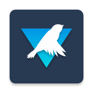

<div align="center">



# Grayjay Thor

### Grayjay, made for two screens.

Watch video on the upper display. Search, browse and control playback below.

[](https://github.com/Tufein/GrayjayThor/releases)
[](https://github.com/Tufein/GrayjayThor/releases/tag/v396-thor.0.1.0)
[](docs/verification/2026-10-31.md)
[](LICENSE.md)

**[Download the APK](https://github.com/Tufein/GrayjayThor/releases/download/v396-thor.0.1.0/Grayjay-Thor-396-arm64-debug.apk)**
&nbsp; · &nbsp; [All releases](https://github.com/Tufein/GrayjayThor/releases)
&nbsp; · &nbsp; [Installation](#installation)
&nbsp; · &nbsp; [Build from source](#build-from-source)

</div>

---

**Grayjay Thor is an unofficial modification of [FUTO's Grayjay](https://gitlab.futo.org/videostreaming/grayjay) for the AYN Thor.** It brings the existing Grayjay player and source plugins to a layout that uses both displays.

> **Early preview:** the build, twelve automated checks and an emulator playback check pass. Physical AYN Thor hardware and online source plugins have not yet been validated. This release is a debug-signed test build.

## A place for everything

| Display | What you see |
| --- | --- |
| **Upper display** | Video and subtitles, with a full-screen video window. |
| **Lower display** | Grayjay's interface: search, sources, playlists, comments and playback controls. |

A single Media3/ExoPlayer session keeps the video, audio, playback position and controls together.

- **Keep your sources.** Uses the original stable Grayjay source plugins, including YouTube and the other bundled providers. Configure them through Grayjay's Sources page.
- **Choose your layout.** Swap the video and controls displays in the Thor settings.
- **Use the controller.** Play, pause and seek with START and the shoulder buttons, while keeping the D-pad and A available for navigation.
- **Use one screen when needed.** The regular player takes over when a second display is unavailable or Android refuses a second-display launch.
- **Keep both apps installed.** The separate package ID, `com.futo.platformplayer.thor`, allows installation alongside regular Grayjay.

## Installation

1. Download **[Grayjay-Thor-396-arm64-debug.apk](https://github.com/Tufein/GrayjayThor/releases/download/v396-thor.0.1.0/Grayjay-Thor-396-arm64-debug.apk)** from the release page.
2. Install the APK on your Thor. If Android prompts you, allow installation from the app you used to open the APK.
3. Turn on **both displays**, then launch **Grayjay Thor (unofficial)** from its app icon.
4. Set up your video sources through the normal Grayjay Sources page and choose a video.

Open **Settings → Thor dual screen** to enable or disable the layout, swap displays, or toggle controller shortcuts. After changing the display layout, reopen the app from its icon.

You can also download the release ZIP, which includes the APK, setup notes, the original license, a source patch and verification output.

## Controller shortcuts

| Button | Action |
| --- | --- |
| **START** | Play or pause; restart a video that has ended. |
| **L1** | Seek backward 10 seconds when seeking is supported. |
| **R1** | Seek forward 10 seconds when seeking is supported. |
| **D-pad / A** | Standard interface navigation. |
| **Back on the video display** | Bring the controls display to the front. |

## Scope and updates

The dual-screen changes apply to the **normal video player**. The separate Shorts player and casting retain their original Grayjay behavior.

Source plugins can update through Grayjay as usual. Thor app updates are installed manually from this repository's releases. Accounts and settings are stored separately from regular Grayjay; use Grayjay's existing export/import tools to transfer data.

For future builds, keep the same signing key to install an update over an existing installation. A build signed with a different key requires a separate migration or reinstall.

## Verification

| Check | Result |
| --- | --- |
| Thor APK and Android test APK build | Passed |
| Display selection and fallback | 8 unit tests passed |
| Player transfer, state preservation and activity recovery | 4 Android tests passed |
| Local MP4 on one display with controls on the other | Checked in the emulator |
| Simulated START and R1 input | Pause confirmed; seek advanced exactly 10,000 ms |
| APK signature and 16 KiB ZIP alignment | Verified |

The twelve-check badge records this validation run; it is not a live CI badge. Details and test output are available in the **[verification record](docs/verification/2026-10-31.md)**.

Hardware-specific display behavior and online provider playback still need testing on a physical Thor.

## Build from source

You will need **JDK 17 or newer**, **Git LFS**, the **Android SDK platform 36**, Android build tools and an `ANDROID_HOME` pointing to your SDK directory. The project includes the Gradle 8.13 wrapper.

```sh
git clone https://github.com/Tufein/GrayjayThor.git
cd GrayjayThor

export ANDROID_HOME=/path/to/android-sdk
./scripts/build-thor.sh
```

The script fetches the pinned GitLab submodules and FFmpeg LFS asset, builds the Thor APKs and runs the eight display-selection tests. It builds both `arm64-v8a` for the Thor and `x86_64` for an emulator.

The APKs are written to:

```text
app/build/outputs/apk/thor/debug/
```

Install a local build over USB:

```sh
adb install -r app/build/outputs/apk/thor/debug/app-thor-arm64-v8a-debug.apk
```

Run the four Android tests with a connected device or emulator:

```sh
./gradlew :app:connectedThorDebugAndroidTest \
  -PtargetAbis=arm64-v8a,x86_64 \
  -Pandroid.testInstrumentationRunnerArguments.class=com.futo.platformplayer.thor.ThorPlayerOutputTest
```

The Thor build keeps the upstream numeric API version **396**, independent of this fork's Git tags. This preserves the version information used by source plugins.

## Credits and license

The original Grayjay application is developed by **[FUTO](https://futo.org/)**. This fork is based on [FUTO's GitLab source](https://gitlab.futo.org/videostreaming/grayjay), commit:

```text
c3ac3017382e9829b25916378d951463e5a93a36
```

This is an unofficial, modified build. FUTO's original copyright notices, licensing and payment functionality are retained. The software is governed by the **[Source First License 1.1](LICENSE.md)**, including its non-commercial use and distribution terms.

[Original Grayjay documentation](UPSTREAM-README.md) · [Detailed Thor notes in Dutch](THOR.md) · [Third-party licenses](app/src/main/assets/licenses)
